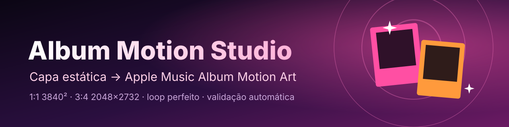
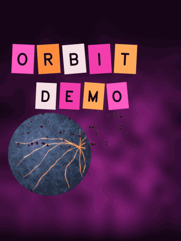

<div align="center">



# 🎬 Apple Music Album Motion Art

**Turn your release cover into Apple Music *Album Motion Art* — creative, perfectly looped and pre-validated against the rules that get files rejected.**

[](LICENSE)


[🇧🇷 Português](README.md) · [🇺🇸 English](README.en.md)



<sub>Demo generated by this project on a procedural cover (`examples/demo`). 12 s loop, 3:4.</sub>

</div>

---

## What is it?

Apple Music lets you replace the static album cover with a **short looping video** (*Album Motion Art*). Apple's official toolkit ships After Effects templates but **does not create the animation**. This project does:

> **1 cover (or layered PSD) → 2 deliverables** (`[UPC]_1x1.mov` and `[UPC]_3x4.mov`) with layered animation, **frame 0 identical to the cover**, **seamless loop** and automatic validation of Apple/distributor rules.

## What's new in v2.1
- **Real PSDs:** roles by layer type/name/group, safe default motion, a `camera` layer and an auto-fitted `grade` adjust layer (error vs. Photoshop ~5–11 → ~1–2.5/255). Tested on three real 2000²/3000²/4000² PSDs.
- **`studio.py doctor [--bench] [--selftest]`**: environment check + end-to-end self-test + render-time estimate for *your* machine (typical: **3–25 min per format**, 12 s @ 30 fps).
- **Windows/macOS/Docker prepared** (Unicode paths, UTF-8 console, CI matrix, Dockerfile) — verified on Linux only; CI will confirm the rest on first push.
- **Apple compliance:** `--container mp4`, `--static`, Parental Advisory sticker warning/removal, duration/frame-rate checks. Official sources in `docs/05`.
- **Privacy guard:** `.gitignore` + `tests/test_repo_privacy.py` block unauthorized media.

## What's new in v2 — a motion editor in your terminal (and inside Claude)
- 🧱 **Compositing engine**: layers (image, text, generator, lock), **keyframes/expressions** (always loop-closed), blend modes, effects.
- 🎨 **Flexible input**: PNG/JPG/TIFF at **2048, 3000, 3840/4K** (square) and **layered PSD** (each layer becomes an animatable layer).
- 🔍 **Native resolution**: the 1:1 engine runs up to **3840 px** (measured peak RAM ≈ 1.3 GB at 3000 px, ≈ 1.8 GB at 4K).
- 🧩 **Unlimited effects**: 8 layer effects + 11 generators + **Python plugins** (`new-effect`).
- ✏️ **Editor commands**: `init · info · add-layer · add-effect · set · move · remove · preview · check · render` (validated before saving).
- 🛡️ **Automatic `check`**: renders every frame at low-res and rejects frame 0 ≠ cover, loop jumps, flash/strobe, blown-out highlights.
- 🤖 **An agent that asks**: the Claude skill/agent runs a creative-direction conversation, shows previews, iterates and **writes new effects** when needed.

The simple v1 flow (`render_motion.py` + `config.json`) still works.

## Install
Requirements: Python 3.9+, FFmpeg/FFprobe, ~3 GB free RAM, ~1 GB disk for AI models (optional).
```bash
git clone https://github.com/monkeyinspace-tech/apple-music-album-motion-art.git && cd apple-music-album-motion-art
python3 -m venv .venv && source .venv/bin/activate      # Windows: .venv\Scripts\activate
pip install -r requirements.txt                          # core + PSD reading
pip install -r requirements-ai.txt                       # subject cut-out on flat covers (rembg) — optional
```
Per-OS guide (Ubuntu, macOS, Windows, Docker): [`docs/01-instalacao.md`](docs/01-instalacao.md) *(Portuguese)*.

## Quick start (no cover and no AI needed)
```bash
python scripts/studio.py init examples/demo/demo_cover.png work/demo --template examples/demo/demo_config.json
python scripts/studio.py info work/demo
python scripts/studio.py preview work/demo --sheet          # work/demo/preview/contact_sheet.png
python scripts/studio.py check work/demo
python scripts/studio.py render work/demo --upc 0000000000000 --formats 3x4 --outdir out
python scripts/validate_motion.py out/0000000000000_3x4.mov --cover work/demo/source_flat.png
```

## 3000×3000, 4K and PSD
```bash
python scripts/studio.py init my_cover.png work/proj --template punk-impact --intensity bold   # 2048 / 3000 / 4K
python scripts/studio.py init my_cover.psd work/proj --impact "[900,1300]"                      # layered PSD
python scripts/studio.py init rectangular.jpg work/proj --fit crop                              # not square? crop or extend
```

## Edit like an editor
```bash
studio.py add-layer  work/proj --id embers --effect embers --param origin=[742,1325] --param count=90
studio.py add-effect work/proj title glow --param radius=40
studio.py set        work/proj subject.transform.rotation '{"wave":"sin","amp":2}'
studio.py preview    work/proj --gif work/preview.gif
```
Animatable values accept waves, envelopes, smooth wiggle and keyframes — always loop-closed (open keyframes are rejected).

## Create your own effects
`python scripts/studio.py new-effect rain --kind generator --project work/proj` → edit the generated `.py` → `add-layer` → `check`. See [`docs/14`](docs/14-criar-efeitos.md) *(Portuguese)*. ⚠️ Plugins are code that runs on your machine.

## Templates
`punk-impact` · `portrait-clean` · `typographic-poster` · `abstract-flow` · `minimal` — see [`configs/templates`](configs/templates). Only `punk-impact` was used on a real release; `portrait-clean` is untested on a real cover. Always run `preview`.

## Honest limitations
AI cut-outs can fail on hair/thin objects (use a PSD) · complex Photoshop PSDs (smart objects, advanced layer styles, adjustment layers) may not render identically — rasterize first · covers under 2048 px are upscaled in 1:1 · the 3:4 top/bottom extension is generated from the edges · the video is silent (no audio sync) · tested on Linux only · the validator is a local pre-check — **official approval comes from your distributor/Apple** · not affiliated with Apple.

## Docs
Most documentation is in Portuguese (see the table in [README.md](README.md#-documentação-completa)). Contributions to translate are welcome — see [CONTRIBUTING.md](CONTRIBUTING.md).

## License
[MIT](LICENSE). AI models downloaded by `rembg` have their own licenses.

<div align="center"><sub>Made with 🐒 by <b>Monkey In Space Music Group</b> · Apple Music is a trademark of Apple Inc.</sub></div>
