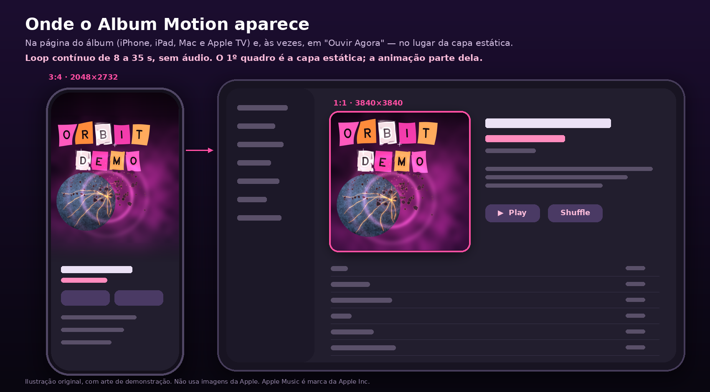
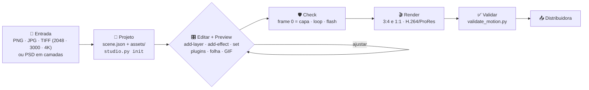
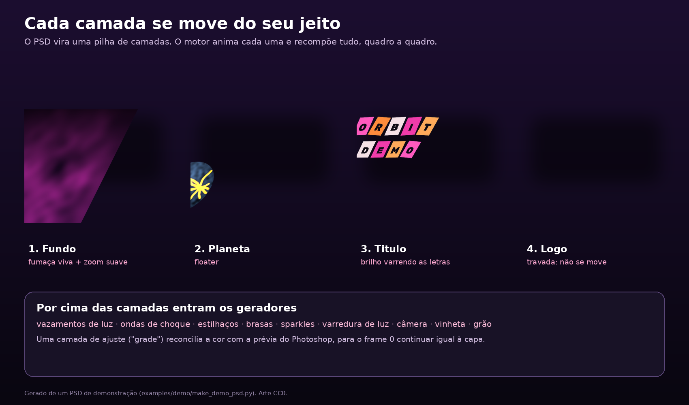
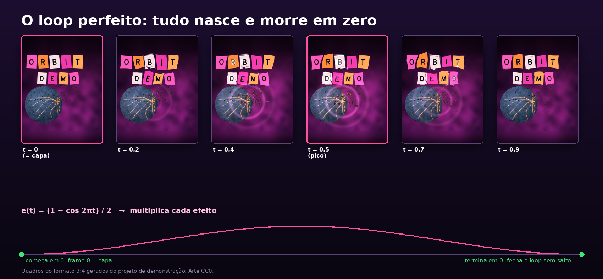

<div align="center">


# 🎬 Album Motion Studio

**Um estúdio de motion em Python (e dentro do Claude) que transforma a capa — ou o PSD — do seu lançamento em *Apple Music Album Motion Art*: com camadas, keyframes, efeitos, plugins e validação automática.**

[](LICENSE)
[](https://github.com/monkeyinspace-tech/album-motion-studio/releases)
[](https://github.com/monkeyinspace-tech/album-motion-studio/actions/workflows/ci.yml)


[](https://github.com/uaigoiano-max/album-motion-studio/actions)

[🇧🇷 Português](README.md) · [🇺🇸 English](README.en.md)

 &nbsp; 

<sub>Esquerda: capa plana (camadas separadas por IA). Direita: PSD em camadas, intensidade `bold`. Geradas por este projeto sobre arte procedural (`examples/demo`). Loop de 12 s, formato 3:4.</sub>

</div>

---

## 🎯 Para que serve

A Apple Music permite trocar a capa estática do álbum por um **vídeo curto em loop** (*Album Motion Art*). O toolkit oficial traz templates de After Effects, mas **não cria a animação**. Este projeto cria:

> **1 capa (ou PSD) → 2 vídeos prontos** — `[UPC]_1x1.mov` (3840×3840) e `[UPC]_3x4.mov` (2048×2732) — com **frame 0 idêntico à capa**, **loop sem salto** e checagem das regras da Apple/distribuidora.

<div align="center"></div>

## 👥 Quem usa

| Público | O que ganha |
|---|---|
| 🎤 **Artistas independentes** | Capa animada para cada lançamento sem contratar um motion designer |
| 🏷️ **Selos e gravadoras** | Esteira repetível: PSD/capa → vídeos validados, com histórico (`scene.json`) |
| 📦 **Distribuidoras / equipes de arte** | Validador que reprova antes do envio (SAR, bitrate, loop, flash…) |
| 🎞️ **Motion designers** | Motor por camadas, keyframes e plugins em Python para automatizar o repetitivo |
| 🤖 **Quem usa IA (Claude/Copilot)** | Um agente que pergunta o que animar, mostra previews e cria efeitos novos |

## ⚙️ Como funciona



1. **Camadas** — PSD vira uma pilha de camadas; capa plana é separada por IA (fundo / título / pessoa). Cada camada recebe movimento próprio.
2. **Efeitos** — fumaça viva, título com brilho, trincas pulsando, ondas de choque, estilhaços, brasas, sparkles, câmera, vinheta… ou **plugins seus**.
3. **Loop perfeito por construção** — todo efeito nasce e morre em zero.

<div align="center"></div>
<div align="center"></div>

## ✨ Recursos

| | |
|---|---|
| 🎨 **Entrada flexível** | PNG/JPG/TIFF quadrados em **2048, 3000, 3840/4K** e **PSD em camadas** (testado em PSDs reais com smart objects, grupos e camadas de ajuste) |
| 🧩 **Motor de composição** | Camadas `image/text/generator/lock/adjust`, keyframes e expressões em **loop fechado**, blend modes |
| 🪄 **Catálogo + plugins** | 8 efeitos de camada + 11 geradores; `new-effect` cria um efeito seu em Python |
| 🛡️ **`check` automático** | Reprova frame 0 ≠ capa, salto no loop, flash/strobe, brilho estourado |
| ✅ **Validador** | Resolução, SAR 1:1, **45–100 Mbps**, duração, mudo, Rec.709, frame rate, flash, loop |
| 🧹 **Selo explícito** | Detecta e remove o selo *Parental Advisory* (a Apple não o permite na arte de motion) |
| 📐 **3:4 com Safe Area** | Arte de ponta a ponta; só topo/base são estendidos |
| 🩺 **`doctor`** | Diagnóstico do ambiente, autoteste e **estimativa do tempo de render** da sua máquina |
| 🤖 **Skill + agente** | Conversa de direção criativa, previews, iteração e criação de efeitos (Claude / Copilot) |

## 🛠 Instalação

**Requisitos:** Python 3.9+, FFmpeg/FFprobe, ~3 GB de RAM (PSD 4000² com motor 4K usa ~2,8 GB).

### One-click (recomendado)

```bash
# Linux / macOS
git clone https://github.com/monkeyinspace-tech/album-motion-studio.git
cd album-motion-studio
bash install.sh

# Windows (PowerShell)
git clone https://github.com/monkeyinspace-tech/album-motion-studio.git
cd album-motion-studio
powershell -ExecutionPolicy Bypass -File install.ps1
```

O instalador cria o venv, instala as dependências, instala o FFmpeg (via winget/brew/apt) se faltar e roda o autoteste.

### Manual

```bash
git clone https://github.com/monkeyinspace-tech/album-motion-studio.git
cd album-motion-studio
python3 -m venv .venv && source .venv/bin/activate     # Windows: .venv\Scripts\activate
pip install -r requirements.txt                         # núcleo + leitura de PSD
pip install -r requirements-ai.txt                      # (opcional) recorte de pessoa em capa plana
python scripts/studio.py doctor --selftest              # confere tudo em ~1 min
```
Windows, macOS, Docker: [`docs/01`](docs/01-instalacao.md) e [`docs/17`](docs/17-compatibilidade.md).

## 🚀 Início rápido

```bash
# demo (sem capa, sem IA)
python scripts/studio.py init examples/demo/demo_cover.png work/demo --template examples/demo/demo_config.json
python scripts/studio.py preview work/demo --sheet          # work/demo/preview/contact_sheet.png
python scripts/studio.py check work/demo
python scripts/studio.py render work/demo --upc 0000000000000 --formats 3x4 --outdir out
python scripts/validate_motion.py out/0000000000000_3x4.mov --cover work/demo/source_flat.png

# sua capa / PSD
python scripts/studio.py init minha_capa.psd work/proj --impact "[900,1300]"
python scripts/studio.py init minha_capa.png work/proj --template punk-impact --remove-badge
```
Edição (`add-layer`, `add-effect`, `set`…): [`docs/10`](docs/10-motion-studio.md) · formato da cena: [`docs/11`](docs/11-formato-da-cena.md) · efeitos: [`docs/12`](docs/12-catalogo-de-efeitos.md) · PSD: [`docs/13`](docs/13-photoshop-psd.md) · plugins: [`docs/14`](docs/14-criar-efeitos.md).

## ⏱ Quanto tempo leva?

**De ~3 a ~25 min por formato** (12 s @ 30 fps), medido em 1 CPU — o seu PC provavelmente é mais rápido.

| Material | 3:4 | 1:1 |
|---|:-:|:-:|
| Capa plana simples/completa (2048) | **3–4 min** | **8–10 min** |
| PSD real 2000²–3000² (16–30 camadas, ajustes) | **~9 min** | **9–19 min** |
| Capa/PSD 4K (motor 3840) | — | **17–23 min** |

Rápido com poucas camadas e 3:4; mais lento com PSDs complexos, 1:1 nativo 3000/4K e durações longas. Estime a **sua** máquina: `python scripts/studio.py doctor --bench`. Detalhes: [`docs/16`](docs/16-desempenho.md).

## 📐 Regras da Apple que o projeto cobre

<div align="center"></div>

H.264 **45–100 Mbps** (ou ProRes 422/4444) · **SAR 1:1** · mudo · Rec.709 · 8–35 s (algumas distribuidoras exigem 15–35 s: o projeto **avisa**) · primeiro frame = capa estática · sem selo *Parental Advisory* na arte · sem flashes. Fontes oficiais e divergências entre distribuidoras: [`docs/05`](docs/05-especificacoes-apple.md) — Apple: [Motion Album Artwork](https://help.apple.com/itc/musicstyleguide/en.lproj/itc7d4b161d8.html) · [Album Motion Art Delivery](https://itunespartner.apple.com/music/support/5245-album-motion-art-delivery).

## 🤖 Skill e agente (Claude / Copilot)

A pasta [`claude/`](claude/) traz um **skill** e **agentes** que atuam como diretor de motion: **perguntam** o que você quer animar, montam as camadas, mostram previews, iteram, criam efeitos que não existem, rodam o `check` e validam. `make skill` gera `dist/apple-motion-art.skill`. Guia: [`docs/07`](docs/07-skill-e-agente.md) · perguntas e ideias: [`docs/15`](docs/15-diretor-criativo.md).

## 🧰 Templates

| Template | Para qual capa | Pessoa (IA) |
|---|---|:-:|
| `punk-impact` | Caótica/zine/hyperpop: pessoa + lettering + impacto | ✅ |
| `portrait-clean` | Retrato/foto — recorte **automático** da pessoa | ✅ |
| `typographic-poster` · `abstract-flow` · `minimal` | Tipografia · abstrata · ponto de partida | ❌ |

`punk-impact` e `portrait-clean` (recorte automático) foram testados em **capa real**; os demais têm preview testado no CI. Ajuste e rode sempre o `preview`.

## 🖥 Compatibilidade

Testado em **Linux**. **Windows, macOS e Docker** estão preparados (caminhos Unicode, console UTF-8, CI e Dockerfile), mas **ainda não foram executados** pelo autor: o CI faz isso no primeiro push, e `studio.py doctor --selftest` confirma no seu computador. Detalhes: [`docs/17`](docs/17-compatibilidade.md).

## 🔒 Privacidade

Tudo roda **localmente**. Capas e PSDs inéditos **não vão para o repositório**: `.gitignore` e um teste (`tests/test_repo_privacy.py`) barram mídia não autorizada. Os exemplos usam **arte própria (CC0)** e ilustrações originais — sem imagens da Apple. Veja [`docs/18`](docs/18-privacidade-e-testes.md).

## ⚠️ Limitações honestas

- Recorte por IA pode errar em cabelo/objetos finos — revise em tela cheia ou use **PSD**.
- PSD: camadas de ajuste/efeitos são **aproximadas** (camada `grade`); smart objects/estilos complexos podem divergir — rasterize.
- Capas < 2048 px são ampliadas no 1:1. O vídeo é **mudo** (sem sincronia com áudio).
- O validador é uma checagem prévia local: a aprovação vem da sua distribuidora/Apple.
- Não é produto oficial da Apple e não garante aprovação.

## 📚 Documentação

[Instalação](docs/01-instalacao.md) · [Guia rápido](docs/02-guia-rapido.md) · [Specs Apple](docs/05-especificacoes-apple.md) · [Troubleshooting](docs/06-validacao-e-troubleshooting.md) · [Skill/agente](docs/07-skill-e-agente.md) · [FAQ](docs/08-faq.md) · [Direitos](docs/09-direitos-e-explicito.md) · [Motion Studio](docs/10-motion-studio.md) · [Cena](docs/11-formato-da-cena.md) · [Efeitos](docs/12-catalogo-de-efeitos.md) · [PSD](docs/13-photoshop-psd.md) · [Plugins](docs/14-criar-efeitos.md) · [Diretor criativo](docs/15-diretor-criativo.md) · [Desempenho](docs/16-desempenho.md) · [Compatibilidade](docs/17-compatibilidade.md) · [Privacidade](docs/18-privacidade-e-testes.md) · [Publicar no GitHub](docs/github-setup.md)

## 🤝 Contribuindo · 📄 Licença

[`CONTRIBUTING.md`](CONTRIBUTING.md) · [`CHANGELOG.md`](CHANGELOG.md) · [MIT](LICENSE) (modelos do `rembg` têm licenças próprias).

<div align="center"><sub>Feito com 🐒 por <b>Monkey In Space Music Group</b> · <a href="https://github.com/uaigoiano-max">@uaigoiano-max</a> · Apple Music é marca da Apple Inc.; este projeto não é afiliado nem endossado pela Apple.</sub></div>
