<div align="center">

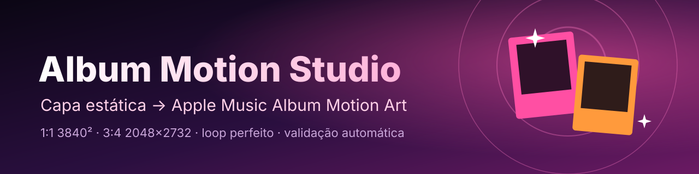

# 🎬 Apple Music Album Motion Art

**Transforme a capa do seu lançamento em Apple Music Album Motion Art — sem After Effects.**

[](LICENSE)
[](https://github.com/monkeyinspace-tech/apple-music-album-motion-art/releases)
[](https://github.com/monkeyinspace-tech/apple-music-album-motion-art/actions/workflows/ci.yml)


[](https://github.com/monkeyinspace-tech/apple-music-album-motion-art/releases/latest)
[](https://github.com/monkeyinspace-tech/apple-music-album-motion-art)

[🇧🇷 Português](README.md) · [🇺🇸 English](README.en.md)

</div>

---

## O que é

A Apple Music permite trocar a capa estática do álbum por um **vídeo curto em loop** (*Album Motion Art*). O toolkit oficial traz templates de After Effects, mas **não cria a animação**.

Este projeto cria: **1 capa (ou PSD) → 2 vídeos prontos** — `[UPC]_1x1.mov` (3840×3840) e `[UPC]_3x4.mov` (2048×2732) — com **frame 0 idêntico à capa**, **loop sem salto** e checagem das regras da Apple/distribuidora.

<div align="center"></div>

## Quem usa

| Público | O que ganha |
|---|---|
| 🎤 **Artistas independentes** | Capa animada para cada lançamento sem contratar um motion designer |
| 🏷️ **Selos e gravadoras** | Esteira repetível: PSD/capa → vídeos validados, com histórico (`scene.json`) |
| 📦 **Distribuidoras / equipes de arte** | Validador que reprova antes do envio (SAR, bitrate, loop, flash…) |
| 🎞️ **Motion designers** | Motor por camadas, keyframes e plugins em Python para automatizar o repetitivo |
| 🤖 **Quem usa IA (Claude/Copilot)** | Um agente que pergunta o que animar, mostra previews e cria efeitos novos |

## Como funciona

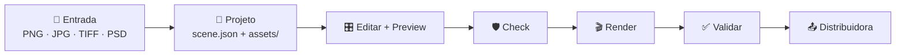

1. **Camadas** — PSD vira pilha de camadas; capa plana é separada por IA. Cada camada recebe movimento próprio.
2. **Efeitos** — fumaça, brilho, trincas, ondas, estilhaços, brasas, sparkles, câmera, vinheta… ou **plugins seus**.
3. **Loop perfeito** — todo efeito nasce e morre em zero.

<div align="center"></div>
<div align="center"></div>

## Exemplos reais

### EKANTA — EU VOU CANTAR

<div align="center">
<table>
<tr>
<td align="center">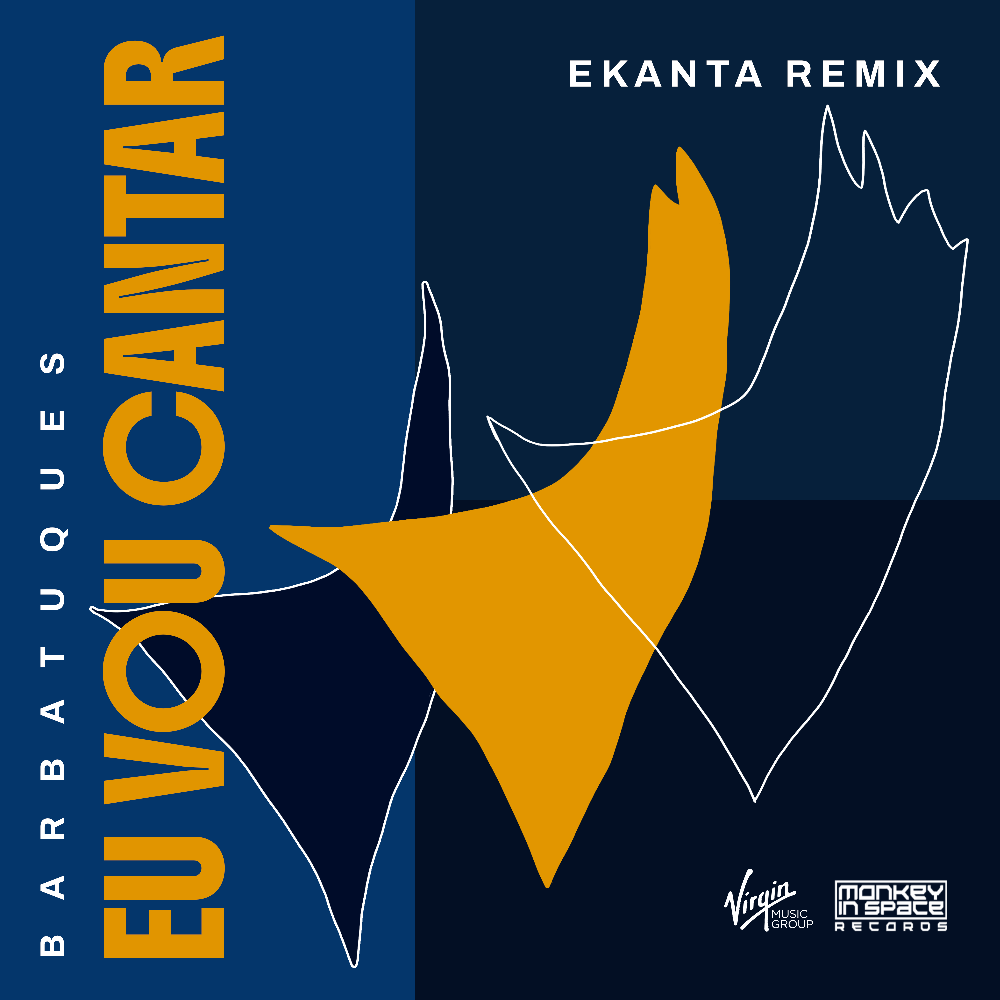</td>
<td align="center">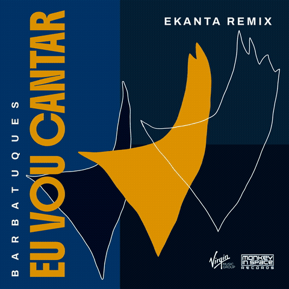</td>
<td align="center">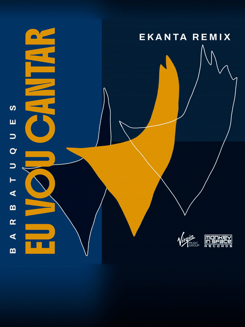</td>
</tr>
<tr>
<td align="center"><sub>Capa 3000×3000</sub></td>
<td align="center"><sub>1:1 · 3840²</sub></td>
<td align="center"><sub>3:4 · 2048×2732</sub></td>
</tr>
</table>
</div>

### Você Chegou

<div align="center">
<table>
<tr>
<td align="center">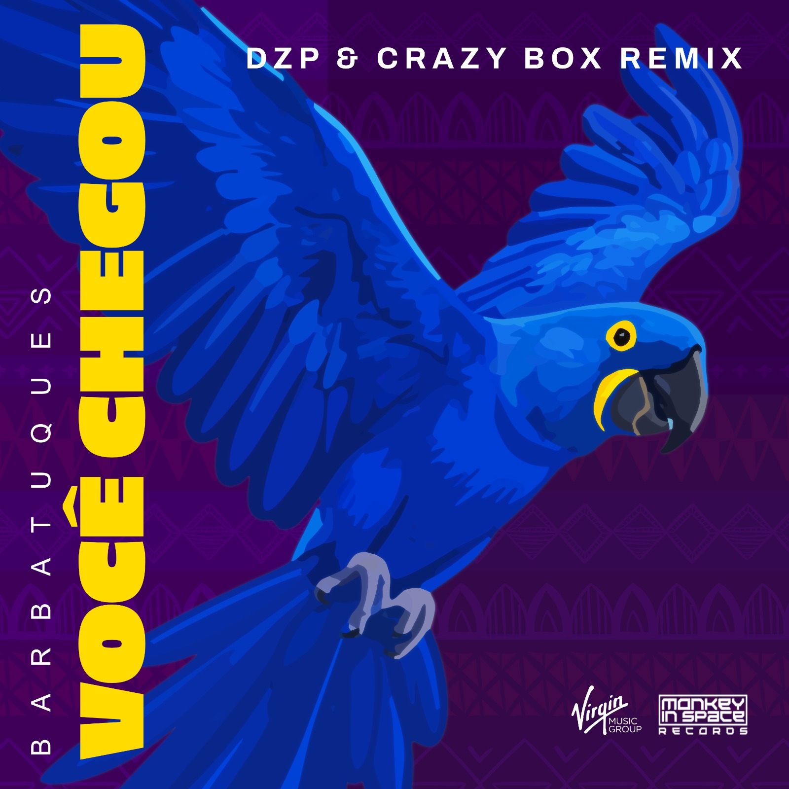</td>
<td align="center">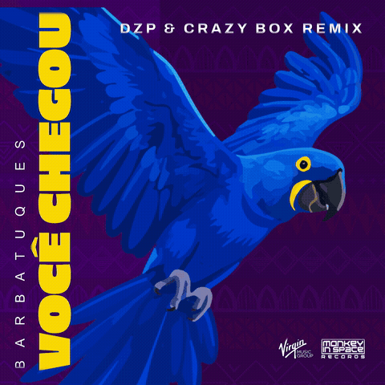</td>
<td align="center">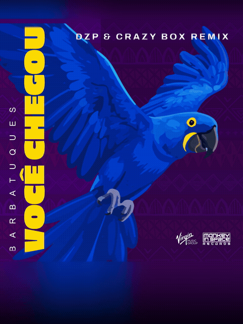</td>
</tr>
<tr>
<td align="center"><sub>Capa JPEG</sub></td>
<td align="center"><sub>1:1 · 3840²</sub></td>
<td align="center"><sub>3:4 · 2048×2732</sub></td>
</tr>
</table>
</div>

### Demo original (capa procedural)

<div align="center">
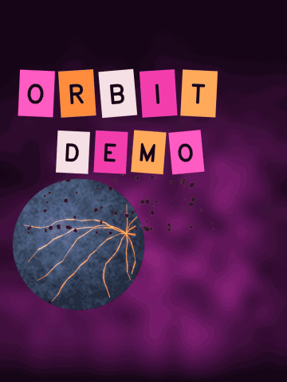 &nbsp;
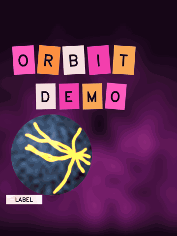
<br>
<sub>Esquerda: capa plana (camadas separadas por IA). Direita: PSD em camadas, intensidade `bold`. Geradas por este projeto sobre arte procedural (`examples/demo`). Loop de 12 s, formato 3:4.</sub>
</div>

## Instalação

```bash
# Linux / macOS
git clone https://github.com/monkeyinspace-tech/apple-music-album-motion-art.git
cd apple-music-album-motion-art
bash install.sh

# Windows (PowerShell)
git clone https://github.com/monkeyinspace-tech/apple-music-album-motion-art.git
cd apple-music-album-motion-art
powershell -ExecutionPolicy Bypass -File install.ps1
```

**Requisitos:** Python 3.9+, FFmpeg/FFprobe, ~3 GB RAM.

## Uso rápido

```bash
# 1. Inicialize
python scripts/studio.py init capa.png work/proj --template punk-impact --intensity bold

# 2. Preview
python scripts/studio.py preview work/proj --sheet

# 3. Check + Render
python scripts/studio.py check work/proj
python scripts/studio.py render work/proj --upc 7891234567890 --formats 3x4 --outdir out

# 4. Valide
python scripts/validate_motion.py out/7891234567890_3x4.mov --cover work/proj/source_flat.png
```

## Recursos

| Recurso | Descrição |
|---|---|
| 🎨 **Entrada flexível** | PNG/JPG/TIFF (2048, 3000, 4K) e PSD em camadas |
| 🧩 **Motor de composição** | Camadas, keyframes, expressões em loop fechado, blend modes |
| 🪄 **Catálogo + plugins** | 8 efeitos de camada + 11 geradores; crie os seus |
| 🛡️ **Check automático** | Frame 0, loop, flash, brilho estourado |
| ✅ **Validador** | Resolução, SAR 1:1, 45–100 Mbps, duração, mudo, Rec.709 |
| 🧹 **Selo explícito** | Detecta e remove Parental Advisory |
| 📐 **3:4 Safe Area** | Arte de ponta a ponta; só topo/base estendidos |
| 🩺 **Doctor** | Diagnóstico + estimativa de tempo de render |
| 🤖 **Skill + agente** | Diretor criativo para Claude / Copilot |

## Templates

| Template | Para qual capa | IA |
|---|---|:-:|
| `punk-impact` | Caótica/zine/hyperpop | ✅ |
| `portrait-clean` | Retrato/foto (recorte automático) | ✅ |
| `typographic-poster` · `abstract-flow` · `minimal` | Tipografia · abstrata · ponto de partida | ❌ |

`punk-impact` e `portrait-clean` (recorte automático) foram testados em **capa real**; os demais têm preview testado no CI. Ajuste e rode sempre o `preview`.

<div align="center">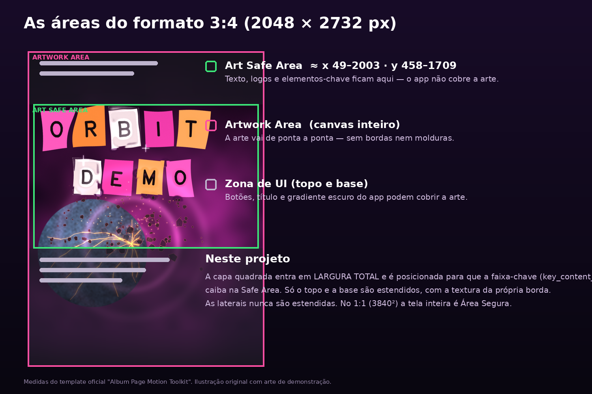</div>

## Compatibilidade

Testado em **Linux**. Windows, macOS e Docker preparados (CI matrix). `studio.py doctor --selftest` confirma no seu PC.

## Documentação

[Instalação](docs/01-instalacao.md) · [Guia rápido](docs/02-guia-rapido.md) · [Specs Apple](docs/05-especificacoes-apple.md) · [Troubleshooting](docs/06-validacao-e-troubleshooting.md) · [Skill/agente](docs/07-skill-e-agente.md) · [FAQ](docs/08-faq.md) · [Direitos](docs/09-direitos-e-explicito.md) · [Motion Studio](docs/10-motion-studio.md) · [Cena](docs/11-formato-da-cena.md) · [Efeitos](docs/12-catalogo-de-efeitos.md) · [PSD](docs/13-photoshop-psd.md) · [Plugins](docs/14-criar-efeitos.md) · [Diretor criativo](docs/15-diretor-criativo.md) · [Desempenho](docs/16-desempenho.md) · [Compatibilidade](docs/17-compatibilidade.md) · [Privacidade](docs/18-privacidade-e-testes.md) · [Publicar no GitHub](docs/github-setup.md)

## 🏢 Créditos e licença

<div align="center">

<a href="https://github.com/monkeyinspace-tech">

</a>

<br><br>

<b>Criado por Monkey In Space Music Group</b>

<br>

<sub>Pensando em colaborar e ajudar <b>artistas</b>, <b>gravadoras</b> e <b>distribuidoras</b> a produzir <b>Apple Music Album Motion Art</b> com qualidade profissional, de forma repetível e acessível.</sub>

<br><br>

<table>
<tr>
<td align="center" width="33%">
<b>Thiago Monteiro</b>
<br>
<sub>Monkey In Space</sub>
<br>
<a href="https://github.com/uaigoiano-max"></a>
<br>
<a href="https://www.instagram.com/zanonmusic/"></a>
</td>
<td align="center" width="33%">
<b>Licença</b>
<br>
<sub>Código: MIT</sub>
<br>
<a href="LICENSE"></a>
<br>
<sub>Modelos do rembg têm licenças próprias</sub>
</td>
<td align="center" width="33%">
<b>Contribuir</b>
<br>
<sub>Aberto a contribuições</sub>
<br>
<a href="CONTRIBUTING.md"></a>
<br>
<a href="https://github.com/monkeyinspace-tech/apple-music-album-motion-art/issues"></a>
</td>
</tr>
</table>

<br>

<sub>Feito com 🐒 por <b>Monkey In Space Music Group</b> · em colaboração com artistas, gravadoras e parceiros · Apple Music é marca da Apple Inc.; este projeto não é afiliado nem endossado pela Apple.</sub>

</div>